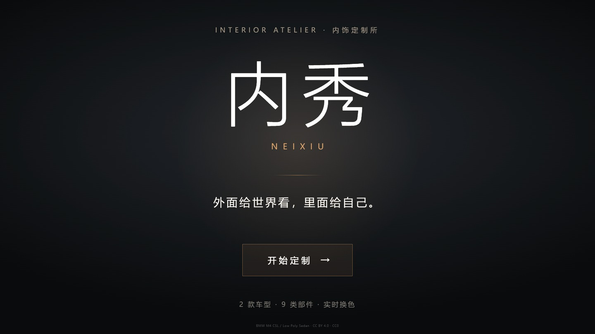

# 内秀 NEIXIU · 3D 汽车内饰定制

**一个故意不卖车的汽车配置器。**

外面给世界看，里面给自己。你可以走进车内，点哪一块、改哪一块，把九类部件调成自己的风格——但这台车没有价格、没有留资、没有「咨询销售」，配完也提不走。

> 车漆，是给别人看的。内饰，才是给自己的。

- 在线体验：<https://primary-student.github.io/car-interior-configurator/>
- 产品短片：1920×1080 / 42.9s / 中文旁白（成片随参赛材料提交，生成流程见 `video/`）



## 能做什么

| 能力 | 说明 |
|---|---|
| **九类部件可改色** | 主驾座椅、副驾座椅、方向盘、仪表台、左门板、右门板、中控台、中控屏边框、车身漆面 |
| **双色板** | 内饰 11 色 + 车漆 11 色，共 121 种组合 |
| **四套预设** | 沉稳商务、米白轻奢、运动红黑、青春气息，一键切换 |
| **坐进去看** | 车顶自动让开，机位固定在前排两座之间，拖拽即可左右环视 |
| **全端自适应** | 桌面 1920×1080 与手机 390×844 共用同一套版式，落地页内容占屏 85% |

## 技术栈

React 19 · TypeScript · Vite 8 · three.js 0.186 · @react-three/fiber 9 · @react-three/drei 10 · Zustand 5

3D 资产为分层 GLB（draco 压缩），按部件索引材质，点击命中即改色。

## 三个真正花时间的坑

**1. 「点击后不该有任何变化」怎么证明**

取消选中描边后，肉眼「看起来没变」不足以交付。于是自己写了 PNG 解码器（zlib inflate + 五种 filter 还原像素），对点击前后的画布做逐像素比对：**0 / 544,000 像素差异**，7 条断言。这个比对同时抓出过一个误报——drei 的 Stats 帧率 HUD 每帧数字都在变，把左上 140×70 区域排除后差异才真正归零。反过来验证「该变」的情况时，换色能跑出 6 万像素级差异，说明比对本身有效。

**2. GLB 材质实例被共用，改一处全身跟着变**

模型里方向盘皮革与门板上饰板指向同一个 material 实例，改方向盘颜色，门板同步变红。修法是建立 `Mesh → PartId` 归属表，按归属 clone 材质再回写 `mesh.material`，让每类部件拿到独立实例。

**3. 只有软件渲染，1 fps 出不了视频**

测试机 Chromium 只能跑 SwiftShader，1080p 下约 0.85 fps，单张截图 8~11 秒，实时录屏不可能。改成**静帧 + ffmpeg zoompan 运镜**：逐镜截静帧，用 zoompan 造推拉、xfade 造转场、adelay 对位旁白，最后合成 1080p 成片。中途踩到的坑包括：整帧运镜会切掉右侧控制面板（改为画布 crop 单独运镜再 hstack 贴回）、跨场景叠化出现鬼影（改 fadeblack）、时间线 `t += dur - XFADE` 在首段的 off-by-one。

## 本地运行

```bash
npm ci
npm run dev        # 开发
npm run build      # 生产构建（不产出 sourcemap）
```

视觉回归与度量脚本（需先起 dev server）：

```bash
node scripts/preview-landing.mjs   # 落地页 11 组断言 × 桌面/移动双端
node scripts/preview-nochange.mjs  # 点击零变化 7 条断言 + 像素级 diff
node scripts/measure-landing.mjs   # 四档视口下落地页内容占屏比
```

## 项目规模

25 次提交 · 1,624 行 TypeScript/TSX · 14 个源文件，构建产物经 GitHub Actions 发布至 GitHub Pages。

## 第三方素材

- BMW M4 CSL 模型：CC BY 4.0，© AshishB2000 / BMW M4 CSL Configurator
- Low Poly Sedan 模型：Quaternius，CC0

## 许可

[PolyForm Noncommercial 1.0.0](LICENSE) —— 可读、可学、可本地运行、可 fork 用于个人研究与教学；**不得商业使用**，**不得将本作品或其衍生作品提交至任何竞赛、评选或作品征集活动**。转载须保留 LICENSE 与署名。商业授权请开 Issue 联系作者。

Copyright (c) 2026 primary-student
